<div align="center">

# remote-agent

**Run Codex and Claude Code on your own computer. Pick up the same session on your phone.**

[](https://github.com/Lewin671/remote-agent/releases/latest)
[](LICENSE)


English · [简体中文](README.zh-CN.md)

<picture>
  <source media="(prefers-color-scheme: dark)" srcset="docs/assets/demo-dark.svg">
  
</picture>

</div>

- **The real CLI** — Codex and Claude Code run natively in tmux; your terminal and your phone drive the same session.
- **End-to-end encrypted** — the relay only stores and forwards ciphertext and never holds a key.
- **Self-hosted** — your relay, your web client, no third-party account.
- **On every screen** — Web, Android and iOS (preview): chat, approvals, live terminal, images (push on Android and Web), all your computers in one list.

The Android app holds the account's authority key, every device signs its own traffic, removal rotates keys immediately, and remote control has a 72-hour lease. See the [security model and limits](docs/reference.md#security-model).

## Try it on the public relay

Install the Android app and create the account there first; save the recovery code it shows once. Then, on macOS or Linux with tmux 3.2+ and a signed-in `codex` or `claude`:

```sh
curl -fsSL https://raw.githubusercontent.com/Lewin671/remote-agent/main/install.sh | sh
remote-agent-service install                                     # run the daemon in the background
remote-agent account join --server https://ra.remote-agent.top --code <code from the app>
remote-agent codex                                               # or: remote-agent claude
```

The relay `ra.remote-agent.top` and the page `remote-agent.top` are run by the maintainer for trying it out: still end-to-end encrypted, but you trust the maintainer's copy of the web page. Up to 8 devices, 2 computers and 200 sessions per account, no uptime promise.

## Host your own

Three pieces: a **relay** on a server, the **web client** on a static host, the **daemon** on your computer. Details in the [self-hosting guide](docs/self-hosting.md).

**1. Relay** — on a Linux server with Docker and a domain pointing at it:

```sh
curl -fsSL https://raw.githubusercontent.com/Lewin671/remote-agent/main/install.sh | sh -s -- server
# Set RELAY_DOMAIN and ALLOWED_ORIGINS in remote-agent-server/.env, then:
cd remote-agent-server && docker compose up -d --build
```

**2. Web client** — static files for Cloudflare Pages or any HTTPS host:

```sh
curl -fsSL https://raw.githubusercontent.com/Lewin671/remote-agent/main/install.sh | sh -s -- web
npx wrangler pages deploy remote-agent-web --project-name <your-project>
```

> [!IMPORTANT]
> Put the relay and the web client under the same registrable domain, such as `ra.example.com` and `app.example.com`. Some content blockers drop cross-site WebSockets, and the client then signs in but never connects.

**3. Your computer** — macOS or Linux with tmux 3.2+ and a signed-in `codex` or `claude`:

```sh
curl -fsSL https://raw.githubusercontent.com/Lewin671/remote-agent/main/install.sh | sh
remote-agent-service install                                # run the daemon in the background
remote-agent account join --server https://ra.example.com --code <code from the app>
remote-agent codex                                          # or: remote-agent claude
```

Create the account in the Android app (it asks for the relay's setup token) and use the code it shows to join this computer; the session you just started is already there.

## Status and limitations

- **Pre-1.0.** Upgrade all components together and read the release notes first; stored data may have to be recreated.
- **The client UI is in Simplified Chinese.**
- **iOS is a preview:** build it from source with Xcode; no App Store or TestFlight build and no push yet, tested only in the simulator.
- **No Android push on a self-hosted relay:** the published app gets pushes only through the maintainer's relay; use the web client's Web Push instead.
- **One person per account.** No teams or sharing; a relay can host many separate accounts.

## More

- [Reference](docs/reference.md) — components, commands, security model, downloads and verification, updating
- [Self-hosting guide](docs/self-hosting.md) · [Development](docs/development.md) · [AGENTS.md](AGENTS.md) for contributors and coding agents
- Bugs: [Issues](https://github.com/Lewin671/remote-agent/issues) (never paste keys, tokens, pairing links or raw logs) · Vulnerabilities: [security advisories](https://github.com/Lewin671/remote-agent/security/advisories/new)

## License

[AGPL-3.0](LICENSE). If you run a modified version as a network service, offer its source to that service's users.
