<div align="center">

# remote-agent

**Use Claude Code, Codex and Antigravity from your phone: the real CLI, running in tmux on your own computer.**

Open-source remote control for AI coding agents. Chat, approve permissions, watch the live terminal, send files and schedule runs from the web, Android or iOS. End-to-end encrypted and self-hostable.

[](https://github.com/Lewin671/remote-agent/releases/latest)
[](LICENSE)


[Quick start](#quick-start-on-the-public-relay) · [Host your own](#host-your-own) · [Comparison](#how-it-compares) · [FAQ](#faq) · [Reference](docs/reference.md) · [简体中文](README.zh-CN.md)

[](https://apps.apple.com/us/app/remote-agent/id6831608344)

iOS preview · iPhone & iPad · iOS 17+ · US App Store only

<picture>
  <source media="(prefers-color-scheme: dark)" srcset="docs/assets/demo-dark.svg">
  
</picture>

</div>

## What is remote-agent?

remote-agent lets you drive [Claude Code](https://github.com/anthropics/claude-code), [OpenAI Codex CLI](https://github.com/openai/codex) and Antigravity (`agy`) on your Mac or Linux computer from a phone or a browser. A small daemon starts each agent in tmux, exactly as you would in a terminal; the web, Android and iOS clients reach it through a relay that only forwards ciphertext. Your terminal and your phone drive the same session: start a task at your desk, approve its next command from the train, and pick it up again at the keyboard.

## What you can do from your phone

| Feature | What you get |
|---|---|
| **Follow and steer** | Replies, reasoning summaries, tool calls and their results as they stream. Send follow-ups, interrupt, switch model and reasoning effort where supported, compact the context. |
| **Approve** | Permission requests and the agent's questions arrive as cards: tap Allow or Deny, or pick an answer. On Android, approve straight from the notification. |
| **Live terminal** | The actual tmux screen, fitted to your phone, with a bar of special keys. |
| **Images and files** | Send screenshots, photos and any file (up to 100 MiB, six per message); see the images the agent pastes, views or generates. |
| **Start sessions** | Open Claude Code, Codex or Antigravity in any project on any of your computers; sessions are grouped by project. |
| **Schedule runs** | Run a prompt at a set time, on an interval or on a calendar schedule, in a new conversation or by resuming one; get a summary when it finishes. |
| **Get notified** | When a turn ends, an approval is waiting or a scheduled run finishes: Web Push and Android push. |
| **Give the agent tools** | Agents in managed sessions get MCP tools to notify you and to manage their own scheduled tasks. |

## How it works

1. **Your computer**: `remote-agent`, a single Go binary, runs Claude Code, Codex or Antigravity in tmux, follows their transcripts and hooks, and encrypts everything before it leaves the machine. It connects out to the relay, so there are no ports to open and no VPN or public IP to set up.
2. **The relay**: `remote-agent-server` authenticates devices and stores and forwards ciphertext. It never holds a key. Host your own, or try the public one.
3. **Your clients**: the web client (an installable PWA), the Android app and the iOS app (preview) decrypt locally. A device joins by scanning a QR code or entering a pairing code, after both sides compare four symbols.

The client that creates the account is its sole authority and signs membership with its device key; every device signs its own traffic, removing a device rotates keys immediately, and remote control has a 72-hour lease. See the [security model and limits](docs/reference.md#security-model).

## Quick start on the public relay

**1. Create an account** in the web client at [remote-agent.top](https://remote-agent.top), the Android app (the APK on the [latest release](https://github.com/Lewin671/remote-agent/releases/latest)) or the iOS app (preview, on the [US App Store](https://apps.apple.com/us/app/remote-agent/id6831608344)). Save the recovery code it shows once, offline.

**2. Install the daemon** on macOS or Linux with tmux 3.2+ and a signed-in `codex` or `claude`:

```sh
curl -fsSL https://raw.githubusercontent.com/Lewin671/remote-agent/main/install.sh | sh
remote-agent-service install                                     # run the daemon in the background
```

**3. Join and start a session.** Open **Settings › Add device** in the client to get a pairing code, then:

```sh
remote-agent account join --server https://ra.remote-agent.top --code <code from the authority>
remote-agent codex                                               # or: remote-agent claude
```

The session is now on your phone too. The relay `ra.remote-agent.top` and the page `remote-agent.top` are run by the maintainer for trying it out: still end-to-end encrypted, but you trust the maintainer's copy of the web page. Up to 8 devices, 2 computers and 200 sessions per account, no uptime promise.

**Or let your coding agent do steps 2 and 3.** Paste this into Claude Code, Codex or Antigravity:

```text
Install remote-agent on this computer by following
https://github.com/Lewin671/remote-agent#quick-start-on-the-public-relay
Run the installer and `remote-agent-service install`, then stop and ask me for
the pairing code before running `remote-agent account join`.
```

## Host your own

Three pieces: a **relay** on a server, the **web client** on a static host, the **daemon** on your computer. Details in the [self-hosting guide](docs/self-hosting.md).

**1. Relay**: on a Linux server with Docker and a domain pointing at it:

```sh
curl -fsSL https://raw.githubusercontent.com/Lewin671/remote-agent/main/install.sh | sh -s -- server
# Set RELAY_DOMAIN and ALLOWED_ORIGINS in remote-agent-server/.env, then:
cd remote-agent-server && docker compose up -d --build
```

**2. Web client**: static files for Cloudflare Pages or any HTTPS host:

```sh
curl -fsSL https://raw.githubusercontent.com/Lewin671/remote-agent/main/install.sh | sh -s -- web
npx wrangler pages deploy remote-agent-web --project-name <your-project>
```

> [!IMPORTANT]
> Put the relay and the web client under the same registrable domain, such as `ra.example.com` and `app.example.com`. Some content blockers drop cross-site WebSockets, and the client then signs in but never connects.

**3. Your computer**: macOS or Linux with tmux 3.2+ and a signed-in `codex` or `claude`:

```sh
curl -fsSL https://raw.githubusercontent.com/Lewin671/remote-agent/main/install.sh | sh
remote-agent-service install                                # run the daemon in the background
remote-agent account join --server https://ra.example.com --code <code from the authority>
remote-agent codex                                          # or: remote-agent claude
```

Create the account in a client (Web, Android or iOS preview; it asks for the relay's setup token) and use **Settings › Add device** on that authority to join this computer; the session you just started is already there.

## How it compares

| | remote-agent | SSH + tmux from a phone | Claude Code Remote Control |
|---|---|---|---|
| Agents | Claude Code, Codex and Antigravity | Any CLI | Claude Code only |
| On the phone | Chat, approval cards, push notifications, plus the live terminal | A raw terminal | Chat in the Claude app or on claude.ai |
| Network setup | None: everything connects out to the relay | Your computer must be reachable over SSH | None: connects out to Anthropic |
| What carries the session | Your relay or the public one, which sees only ciphertext | A direct connection | Anthropic's servers |
| Session lifetime | Lives in tmux; survives closing the terminal or the app | Lives in tmux | Ends when the local Claude Code process exits |
| Self-hosted, open source | Yes, AGPL-3.0 | Yes | No |

## FAQ

**Can I use Claude Code, Codex or Antigravity on an iPhone or an Android phone?**
Yes. On Android, install the APK from the [latest release](https://github.com/Lewin671/remote-agent/releases/latest); it updates itself. On iPhone, add the web client to the home screen (Web Push works there), or install the iOS preview from the [US App Store](https://apps.apple.com/us/app/remote-agent/id6831608344) (iOS 17+).

**Can the relay read my code or prompts?**
No. Messages, tool output, terminal output, images, files, project names and paths are encrypted on your devices. The relay sees IDs, timestamps, ciphertext sizes and IP addresses. See [what the relay can see](docs/reference.md#security-model).

**Does it use the API, and what does it cost?**
It drives the CLI you are already signed in to, so usage counts against that CLI's own plan or API key; remote-agent makes no model calls of its own. The software is free under AGPL-3.0.

**Do I need a public IP, port forwarding or a VPN?**
No. The daemon and the clients all connect out to the relay over HTTPS and WebSocket.

**Can I keep using the terminal on my computer?**
Yes. The session you start with `remote-agent claude`, `remote-agent codex` or `remote-agent agy`, or attach to with `remote-agent attach <id>`, is the same tmux session the phone sees. Input from every device goes in, in order of arrival.

**What happens when I close the app or lose signal?**
The agent keeps running in tmux, and the client catches up when it reconnects. If the computer sleeps, the agent pauses with it; if the daemon restarts, it reattaches to the sessions still running.

**Does it run on Windows?**
No. The daemon runs on macOS and Linux.

## Status and limitations

- **Pre-1.0.** Upgrade all components together and read the release notes first; stored data may have to be recreated.
- **Antigravity chooses its model and effort at launch.** See [CLI differences](docs/scope.md#mvp-之后要做) for its current session controls.
- **The client UI is in Simplified Chinese.**
- **iOS is a preview:** available only on the [US App Store](https://apps.apple.com/us/app/remote-agent/id6831608344) (iOS 17+); elsewhere, build it from source with Xcode. No push yet.
- **No Android push on a self-hosted relay:** the published app gets pushes only through the maintainer's relay; use the web client's Web Push instead.
- **One person per account.** No teams or sharing; a relay can host many separate accounts.

## Documentation

- [Reference](docs/reference.md): components, commands, security model, downloads and verification, updating
- [Self-hosting guide](docs/self-hosting.md): relay, web client and daemon from a release
- [Development](docs/development.md): building and running from source (in Chinese)
- [AGENTS.md](AGENTS.md): the rules for contributors and coding agents working in this repository (in Chinese)
- Bugs: [Issues](https://github.com/Lewin671/remote-agent/issues) (never paste keys, tokens, pairing links or raw logs) · Vulnerabilities: [security advisories](https://github.com/Lewin671/remote-agent/security/advisories/new)

## License

[AGPL-3.0](LICENSE). If you run a modified version as a network service, offer its source to that service's users.
