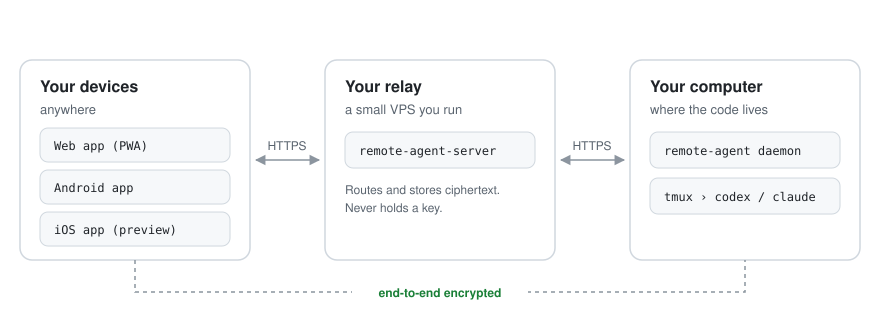

<div align="center">

# remote-agent

**Run Codex and Claude Code on your own computer. Drive them from any device.**

Native CLI sessions in tmux · End-to-end encrypted · Self-hosted

[](https://github.com/Lewin671/remote-agent/releases/latest)
[](LICENSE)


English · [简体中文](README.zh-CN.md)

<picture>
  <source media="(prefers-color-scheme: dark)" srcset="docs/assets/architecture-dark.svg">
  
</picture>

</div>

## Overview

remote-agent lets you leave your desk without leaving your coding agent. You start Codex or Claude Code on your computer as usual; the same session is then available on your phone or in a browser, where you can follow its progress, send the next message, answer its questions, approve or deny permission requests, interrupt it, or open the live terminal.

| | |
|---|---|
| **The real CLI** | Agents run in their own interactive form inside tmux — not through an SDK or a reimplemented chat. The terminal on your desk and the client in your hand operate one and the same session. |
| **End-to-end encrypted** | Messages, tool calls, terminal output, images, project names and paths are encrypted on your devices. The relay only stores and forwards ciphertext and never holds a key. |
| **Self-hosted** | You run the relay on your own server and host the web client yourself. There is no account with a third party and no chat platform in between. |
| **Several computers, one view** | Run a daemon on each machine; clients group every session by project. |

> [!NOTE]
> The client interfaces are currently in Simplified Chinese. The project is pre-1.0 and moves quickly — read [Status and limitations](#status-and-limitations) before relying on it.

## How it works

| Component | Runs on | Role |
|---|---|---|
| **Daemon** (`remote-agent`) | Each computer with your code — macOS or Linux | Hosts agent sessions in tmux, reads their transcripts, relays approvals through CLI hooks, injects input. The same binary is the command-line interface. |
| **Relay** (`remote-agent-server`) | A Linux server you control | Authenticates devices, stores and forwards ciphertext, sends push notifications. Cannot read content. |
| **Web client** | Any static HTTPS host | Installable PWA: conversation view, live terminal, approvals, Web Push. |
| **Android app** | Android 8.0 or later | Native client with a native terminal and approvals from the notification. |

Every device holds the account key; the relay holds none. Devices join an account by scanning a QR code or entering a pairing code, and both sides confirm a short emoji sequence before keys are exchanged.

## Quick start

You need three pieces: a **relay** on a server, the **web client** on a static host, and the **daemon** on your computer. The [self-hosting guide](docs/self-hosting.md) covers each step in detail; the short version follows.

**1. Relay** — on a Linux server with Docker and a domain pointing at it:

```sh
curl -fsSL https://raw.githubusercontent.com/Lewin671/remote-agent/main/install.sh | sh -s -- server
# Set RELAY_DOMAIN and ALLOWED_ORIGINS in remote-agent-server/.env, then:
cd remote-agent-server && docker compose up -d --build
```

**2. Web client** — static files for Cloudflare Pages or any HTTPS host:

```sh
curl -fsSL https://raw.githubusercontent.com/Lewin671/remote-agent/main/install.sh | sh -s -- web
npx wrangler pages deploy remote-agent-web --project-name <your-project>
```

> [!IMPORTANT]
> Put the relay and the web client under the same registrable domain, such as `ra.example.com` and `app.example.com`. Some content blockers drop cross-site WebSockets, and the client then signs in but never connects.

**3. Your computer** — macOS or Linux with tmux 3.2+ and a signed-in `codex` or `claude`:

```sh
curl -fsSL https://raw.githubusercontent.com/Lewin671/remote-agent/main/install.sh | sh
remote-agent-service install                                # run the daemon in the background
remote-agent account init --server https://ra.example.com   # asks for the relay's setup token
remote-agent account pair --web https://app.example.com     # shows a QR code for your phone
remote-agent codex                                          # or: remote-agent claude
```

Scan the QR code with your phone; the session you just started is already there.

## Everyday use

Sessions started from a client and sessions started in a terminal are the same kind of session. From the command line:

| Command | Purpose |
|---|---|
| `remote-agent codex` / `remote-agent claude` | Start a session in the current directory and attach to it |
| `remote-agent ls` | List sessions; IDs may be shortened to any unique prefix |
| `remote-agent attach <id>` | Attach to a running session |
| `remote-agent send <id> <text>` | Send a message without attaching |
| `remote-agent events <id> -f` | Follow a session's events |
| `remote-agent doctor` | Check that the installed CLIs behave as remote-agent expects; run it after upgrading Codex or Claude Code |
| `remote-agent account pair` | Add another device to the account |

`remote-agent --help` lists every command.

## Security model

The relay is treated as untrusted. If your server is compromised, what leaks is metadata, not content.

| Data | Visible to the relay |
|---|---|
| Messages, tool calls, terminal output, approval requests, images | No |
| Project names, paths, git remotes, session titles, machine names | No |
| Account and session keys | No |
| Device, machine and session IDs, timestamps, ciphertext sizes | Yes — needed for routing |
| Whether and when a session ended | Yes |

The web client is deliberately **not** served by the relay: a compromised relay could otherwise replace the page's JavaScript and defeat the encryption. Host it elsewhere, such as Cloudflare Pages. Report vulnerabilities privately through [GitHub security advisories](https://github.com/Lewin671/remote-agent/security/advisories/new), not in public issues.

## Downloads and verification

Each [release](https://github.com/Lewin671/remote-agent/releases/latest) ships every component at the same version:

| File | Contents | Platforms |
|---|---|---|
| `remote-agent-vX.Y.Z-<os>-<arch>.tar.gz` | Daemon and command line, plus `remote-agent-service` for running it in the background | macOS and Linux, arm64 and amd64 |
| `remote-agent-server-vX.Y.Z-linux-<arch>.tar.gz` | Relay, with a Docker Compose setup that includes HTTPS | Linux, arm64 and amd64 |
| `remote-agent-web-vX.Y.Z.tar.gz` | Web client as static files | Any HTTPS static host |
| `remote-agent-vX.Y.Z.apk` | Android app | Android 8.0 and later |
| `SHA256SUMS` | Checksums of all of the above | |

`install.sh` selects the right file, verifies it against `SHA256SUMS`, and installs without root. To inspect it first, download it, read it, and run it with `sh install.sh`. To verify a download by hand:

```sh
sha256sum --check --ignore-missing SHA256SUMS   # macOS: shasum -a 256 --check --ignore-missing SHA256SUMS
```

The Android app is always signed with the same key. Its certificate's SHA-256 fingerprint:

```
8f:ea:c3:68:de:87:29:d5:25:ca:65:f7:40:36:83:27:17:76:68:af:e3:de:06:2a:df:09:3e:df:89:3f:20:cc
```

## Updating

- **Android app:** updates itself from this repository's releases — **Settings › Version**.
- **Daemon:** `remote-agent update check`, `remote-agent update`, and `remote-agent update status`. Automatic updates are off by default; enable them per computer with `remote-agent update auto enable --time 04:00` (local time) and disable them with `remote-agent update auto disable`. The updater verifies size and SHA-256 over HTTPS, swaps the binary atomically, keeps tmux sessions running, and rolls back if the new daemon fails to start. Upgrades that change the protocol or stored data are not applied automatically; follow the release notes instead.
- **Relay and web client:** rerun the installer for the new version.

## Status and limitations

- **Pre-1.0.** Components of different versions are not guaranteed to interoperate, and stored data may have to be recreated between releases. Upgrade the daemon, relay, web client and app together, and read the release notes first.
- **One person per relay.** A relay serves the devices of a single account. There are no teams, sharing, or multiple accounts.
- **No Android push notifications on a self-hosted relay.** The published app receives pushes only through the maintainer's Firebase project. It works normally while open; for notifications on your own relay, use the web client, which supports Web Push everywhere. To use your own Firebase project, build the app from source.
- **No iOS app yet.** A native client is in development; until then, open the web client in Safari and add it to the Home Screen.
- **No support guarantee.** Bug reports are welcome in [Issues](https://github.com/Lewin671/remote-agent/issues). Never paste account secrets, setup tokens, pairing links, or unredacted logs.

## Development

The source tree:

| Path | Contents |
|---|---|
| `cmd/remote-agent`, `cmd/remote-agent-server` | Entry points of the daemon/CLI and the relay (Go) |
| `internal/` | Go packages: daemon, relay server, encryption, Codex and Claude Code integration, updater |
| `proto/`, `gen/` | Protocol definitions (Protocol Buffers, Connect) and generated code |
| `web/` | Web client (TypeScript, React, Vite) |
| `android/`, `ios/` | Native clients (Kotlin with Jetpack Compose; Swift with SwiftUI) |
| `deploy/` | Container image and the self-hosting templates shipped with the relay |
| `scripts/` | Build, test, release and deployment tooling |
| `docs/` | Scope, architecture, measurements of external tools, plan and acceptance records |

To build and run from source, see the [development guide](docs/development.md). The design documents are written in Chinese; start from [docs/README.md](docs/README.md), which says what each document covers. Contributors and coding agents should read [AGENTS.md](AGENTS.md) first: it holds the project's working rules.

## License

remote-agent is free software under the [GNU Affero General Public License v3.0](LICENSE). If you run a modified version as a network service, you must offer its source to that service's users. Release archives include the license texts of bundled third-party software in `THIRD_PARTY_NOTICES.txt`.
