<div align="center">

# remote-agent

**在手机上用 Claude Code、Codex 和 Antigravity：原生 CLI，跑在你自己电脑的 tmux 里。**

开源的 AI 编程 agent 远程控制工具。在网页、Android 或 iOS 上聊天、审批权限、看实时终端、发文件、设定时任务。端到端加密，可以自己部署。

[](https://github.com/Lewin671/remote-agent/releases/latest)
[](LICENSE)


[快速试用](#在公共中继上试用) · [自己部署](#自己部署) · [对比](#和其他方案的区别) · [常见问题](#常见问题) · [参考](docs/reference.zh-CN.md) · [English](README.md)

[](https://apps.apple.com/us/app/remote-agent/id6831608344)

iOS 预览版 · iPhone 和 iPad · iOS 17+ · 仅美区 App Store

<picture>
  <source media="(prefers-color-scheme: dark)" srcset="docs/assets/demo-dark.zh-CN.svg">
  
</picture>

</div>

## remote-agent 是什么？

remote-agent 让你在手机或浏览器上操作自己 Mac 或 Linux 电脑上的 [Claude Code](https://github.com/anthropics/claude-code)、[OpenAI Codex CLI](https://github.com/openai/codex) 和 Antigravity（`agy`）。电脑上的一个小 daemon 在 tmux 里启动 agent，和你在终端里手动启动完全一样；网页、Android 和 iOS 客户端经一台只转发密文的中继连到它。电脑终端和手机操作的是同一个会话：在工位上开个任务，路上在手机上批准它的下一条命令，回到电脑前接着用键盘干。

## 在手机上能做什么

| 功能 | 说明 |
|---|---|
| **跟进和指挥** | 实时看回复、推理摘要、工具调用和结果；追问、打断、在支持的 CLI 中切换模型和推理强度、压缩上下文。 |
| **审批** | 权限请求和 agent 的提问以卡片出现：点允许或拒绝，或者选一个答案。Android 上可以直接在通知里审批。 |
| **实时终端** | 就是 tmux 里那块屏幕，自动适配手机宽度，带特殊按键栏。 |
| **图片和文件** | 发截图、照片和任意文件（单个最大 100 MiB，每条消息最多 6 个）；agent 粘贴、查看或生成的图片也能看到。 |
| **新建会话** | 在任意一台电脑的任意项目里开 Claude Code、Codex 或 Antigravity；会话按项目分组。 |
| **定时运行** | 指定时间、固定间隔或按日历时间运行一段提示词，新开对话或接着某个对话；跑完收到结果摘要。 |
| **通知** | 一轮结束、有审批在等、定时运行完成时提醒：网页推送和 Android 推送。 |
| **给 agent 的工具** | 托管会话里的 agent 能用 MCP 工具通知你、管理自己建的定时任务。 |

## 工作原理

1. **你的电脑**：`remote-agent` 是一个 Go 单二进制，在 tmux 里运行 Claude Code、Codex 或 Antigravity，读取它们的 transcript 和 hook，所有内容离开电脑前先加密。它主动连到中继，不用开端口，也不用 VPN 或公网 IP。
2. **中继**：`remote-agent-server` 负责设备鉴权，存储和转发密文，从不持有密钥。可以自己部署，也可以先用公共中继试试。
3. **客户端**：网页（可安装的 PWA）、Android App 和 iOS App（预览）在本机解密。新设备扫二维码或输入配对码加入，双方先核对四个图案。

建账户的客户端是账户的唯一管理端，用设备密钥签成员状态；每台设备自己签名，删除设备时立即轮换密钥，远程控制受 72 小时租约约束。见[安全模型与限制](docs/reference.zh-CN.md#安全模型)。

## 在公共中继上试用

**1. 建账户**：在网页 [remote-agent.top](https://remote-agent.top)、Android App（[最新 Release](https://github.com/Lewin671/remote-agent/releases/latest) 里的 APK）或 iOS App（预览，[美区 App Store](https://apps.apple.com/us/app/remote-agent/id6831608344)）里建。离线保存只显示一次的恢复码。

**2. 安装 daemon**：在装有 tmux 3.2+、已登录 `codex` 或 `claude` 的 macOS 或 Linux 上：

```sh
curl -fsSL https://raw.githubusercontent.com/Lewin671/remote-agent/main/install.sh | sh
remote-agent-service install                                     # 在后台运行 daemon
```

**3. 加入账户，开一个会话**：在客户端的「设置 › 添加设备」里取配对码，然后：

```sh
remote-agent account join --server https://ra.remote-agent.top --code <管理端显示的配对码>
remote-agent codex                                               # 或：remote-agent claude
```

这个会话现在手机上也有了。中继 `ra.remote-agent.top` 和网页 `remote-agent.top` 由维护者提供，用于试用：同样端到端加密，但你要信任维护者提供的这份网页。每个账户最多 8 台设备、2 台电脑、200 个会话，不保证可用性。

**也可以让编程 agent 替你做第 2、3 步**，把下面这段贴进 Claude Code、Codex 或 Antigravity：

```text
按 https://github.com/Lewin671/remote-agent/blob/main/README.zh-CN.md#在公共中继上试用
在这台电脑上安装 remote-agent：运行安装脚本和 `remote-agent-service install`，
在执行 `remote-agent account join` 之前停下来，问我要配对码。
```

## 自己部署

三样东西：服务器上的**中继**、静态托管上的**网页**、你电脑上的 **daemon**。细节见[自部署指南](docs/self-hosting.zh-CN.md)。

**1. 中继**：一台装了 Docker、有域名指向它的 Linux 服务器：

```sh
curl -fsSL https://raw.githubusercontent.com/Lewin671/remote-agent/main/install.sh | sh -s -- server
# 在 remote-agent-server/.env 里设置 RELAY_DOMAIN 和 ALLOWED_ORIGINS，然后：
cd remote-agent-server && docker compose up -d --build
```

**2. 网页**：静态文件，可部署到 Cloudflare Pages 或任何 HTTPS 托管：

```sh
curl -fsSL https://raw.githubusercontent.com/Lewin671/remote-agent/main/install.sh | sh -s -- web
npx wrangler pages deploy remote-agent-web --project-name <你的项目名>
```

> [!IMPORTANT]
> 中继和网页要放在同一个注册域名下，例如 `ra.example.com` 和 `app.example.com`。部分拦截扩展会丢弃跨站的 WebSocket，网页就会能登录、却一直连不上。

**3. 你的电脑**：macOS 或 Linux，装有 tmux 3.2+ 和已登录的 `codex` 或 `claude`：

```sh
curl -fsSL https://raw.githubusercontent.com/Lewin671/remote-agent/main/install.sh | sh
remote-agent-service install                                # 让 daemon 在后台运行
remote-agent account join --server https://ra.example.com --code <管理端显示的配对码>
remote-agent codex                                          # 或：remote-agent claude
```

先在客户端（网页、Android 或 iOS 预览版）里建账户（会要求输入中继的 setup token），再在管理端的「设置 › 添加设备」里取配对码，把这台电脑加进去；刚才启动的会话就已经在里面了。

## 和其他方案的区别

| | remote-agent | 手机 SSH + tmux | Claude Code Remote Control |
|---|---|---|---|
| 支持的 agent | Claude Code、Codex 和 Antigravity | 任意 CLI | 只有 Claude Code |
| 手机上的形态 | 聊天、审批卡片、推送通知，外加实时终端 | 原始终端 | 在 Claude App 或 claude.ai 上聊天 |
| 网络配置 | 不用：各端都主动连中继 | 电脑要能被 SSH 连到 | 不用：主动连 Anthropic |
| 会话经过哪里 | 你自己的或公共中继，中继只看到密文 | 直连 | Anthropic 的服务器 |
| 会话的生命周期 | 在 tmux 里，关掉终端或 App 都还在 | 在 tmux 里 | 本地 Claude Code 进程退出就结束 |
| 自己部署、开源 | 是，AGPL-3.0 | 是 | 否 |

## 常见问题

**能在 iPhone 或 Android 手机上用 Claude Code、Codex 或 Antigravity 吗？**
能。Android 装[最新 Release](https://github.com/Lewin671/remote-agent/releases/latest) 里的 APK，之后它会自己更新。iPhone 上把网页添加到主屏幕（这样能收网页推送），或者从[美区 App Store](https://apps.apple.com/us/app/remote-agent/id6831608344)安装 iOS 预览版（iOS 17+）。

**中继能看到我的代码和提示词吗？**
看不到。消息、工具输出、终端输出、图片、文件、项目名和路径都在你自己的设备上加密。中继只看到 ID、时间、密文大小和 IP 地址。见[中继能看到什么](docs/reference.zh-CN.md#安全模型)。

**走 API 吗？要花多少钱？**
它操作的是你已经登录的 CLI，用量算在这个 CLI 自己的套餐或 API key 上；remote-agent 自己不调用任何模型。软件本身免费，AGPL-3.0 许可。

**需要公网 IP、端口转发或 VPN 吗？**
不需要。daemon 和客户端都通过 HTTPS 和 WebSocket 主动连中继。

**电脑上还能接着用终端吗？**
能。用 `remote-agent claude`、`remote-agent codex` 启动的会话，或用 `remote-agent attach <id>` 接上的会话，和手机看到的是同一个 tmux 会话。各设备的输入按到达顺序送进去。

**关掉 App 或者断网了会怎样？**
agent 在 tmux 里继续运行，客户端重连后补上进度。电脑睡眠时 agent 跟着暂停；daemon 重启后会重新接上仍在运行的会话。

**支持 Windows 吗？**
不支持。daemon 只能运行在 macOS 和 Linux 上。

## 现状与限制

- **尚未到 1.0。** 各组件一起升级，升级前先读发布说明；存储的数据可能需要重建。
- **Antigravity 在新建时选择模型和推理强度。** 当前会话操作差异见[项目边界](docs/scope.md#mvp-之后要做)。
- **客户端界面是简体中文。**
- **iOS 是预览版：** 只在[美区 App Store](https://apps.apple.com/us/app/remote-agent/id6831608344)上架（iOS 17+），其他地区用 Xcode 从源码构建；还没有推送。
- **自部署中继上 Android 没有推送：** 发布的 App 只能经维护者的中继收推送；请改用网页的 Web Push。
- **一个账户就是一个人。** 没有团队和共享；一台中继可以承载多个互不相干的账户。

## 文档

- [参考](docs/reference.zh-CN.md)：组件、命令、安全模型、下载与校验、更新
- [自部署指南](docs/self-hosting.zh-CN.md)：从 Release 安装中继、网页和 daemon
- [开发](docs/development.md)：从源码构建和运行
- [AGENTS.md](AGENTS.md)：贡献者和编程 agent 在本仓库里工作的规则
- 问题：[Issues](https://github.com/Lewin671/remote-agent/issues)（不要贴密钥、token、配对链接或原始日志）· 安全漏洞：[security advisories](https://github.com/Lewin671/remote-agent/security/advisories/new)

## 许可证

[AGPL-3.0](LICENSE)。把修改后的版本作为网络服务运行时，需要向它的用户提供源码。
