<div align="center">

# remote-agent

**Codex 和 Claude Code 跑在自己的电脑上，同一个会话在手机上接着用。**

[](https://github.com/Lewin671/remote-agent/releases/latest)
[](LICENSE)


[English](README.md) · 简体中文

<picture>
  <source media="(prefers-color-scheme: dark)" srcset="docs/assets/demo-dark.zh-CN.svg">
  
</picture>

</div>

- **原生 CLI**：Codex 和 Claude Code 原样跑在 tmux 里，电脑终端和手机操作的是同一个会话。
- **端到端加密**：中继只存储和转发密文，从不持有密钥。
- **自己部署**：自己的中继、自己的网页，不需要第三方账户。
- **哪个屏幕都能用**：网页、Android 和 iOS（预览）；聊天、审批、推送、实时终端、图片，多台电脑一个列表。

加入新设备需要当前已登记设备批准具体的设备身份，账户密钥本身不能让被移除设备重新登记。移除撤销中继访问，不擦除已下载历史，也不轮换内容密钥，见[安全边界](docs/scope.md#设备加入与移除)。

## 在公共中继上试用

在装有 tmux 3.2+、已登录 `codex` 或 `claude` 的 macOS 或 Linux 上：

```sh
curl -fsSL https://raw.githubusercontent.com/Lewin671/remote-agent/main/install.sh | sh
remote-agent-service install                                     # 在后台运行 daemon
remote-agent account init --server https://ra.remote-agent.top   # 创建你的账户，不需要 token
remote-agent account pair --web https://remote-agent.top         # 显示给手机扫的二维码
remote-agent codex                                               # 或：remote-agent claude
```

中继 `ra.remote-agent.top` 和网页 `remote-agent.top` 由维护者提供，用于试用：同样端到端加密，但你要信任维护者提供的这份网页。每个账户最多 8 台设备、2 台电脑、200 个会话，不保证可用性。

## 自己部署

三样东西：服务器上的**中继**、静态托管上的**网页**、你电脑上的 **daemon**。细节见[自部署指南](docs/self-hosting.zh-CN.md)。

**1. 中继**：一台装了 Docker、有域名指向它的 Linux 服务器：

```sh
curl -fsSL https://raw.githubusercontent.com/Lewin671/remote-agent/main/install.sh | sh -s -- server
# 在 remote-agent-server/.env 里设置 RELAY_DOMAIN 和 ALLOWED_ORIGINS，然后：
cd remote-agent-server && docker compose up -d --build
```

**2. 网页**：静态文件，可部署到 Cloudflare Pages 或任何 HTTPS 托管：

```sh
curl -fsSL https://raw.githubusercontent.com/Lewin671/remote-agent/main/install.sh | sh -s -- web
npx wrangler pages deploy remote-agent-web --project-name <你的项目名>
```

> [!IMPORTANT]
> 中继和网页要放在同一个注册域名下，例如 `ra.example.com` 和 `app.example.com`。部分拦截扩展会丢弃跨站的 WebSocket，网页就会能登录、却一直连不上。

**3. 你的电脑**：macOS 或 Linux，装有 tmux 3.2+ 和已登录的 `codex` 或 `claude`：

```sh
curl -fsSL https://raw.githubusercontent.com/Lewin671/remote-agent/main/install.sh | sh
remote-agent-service install                                # 让 daemon 在后台运行
remote-agent account init --server https://ra.example.com   # 会要求输入中继的 setup token
remote-agent account pair --web https://app.example.com     # 显示给手机扫的二维码
remote-agent codex                                          # 或：remote-agent claude
```

用手机扫二维码，刚才启动的会话就已经在里面了。

## 现状与限制

- **尚未到 1.0。** 各组件一起升级，升级前先读发布说明；存储的数据可能需要重建。
- **客户端界面是简体中文。**
- **iOS 是预览版：** 用 Xcode 从源码构建；还没有 App Store 或 TestFlight 版本，也没有推送，只在模拟器上测过。
- **自部署中继上 Android 没有推送：** 发布的 App 只能经维护者的中继收推送；请改用网页的 Web Push。
- **一个账户就是一个人。** 没有团队和共享；一台中继可以承载多个互不相干的账户。

## 更多

- [参考](docs/reference.zh-CN.md)：组件、命令、安全模型、下载与校验、更新
- [自部署指南](docs/self-hosting.zh-CN.md) · [开发](docs/development.md) · 贡献者和编程 agent 先读 [AGENTS.md](AGENTS.md)
- 问题：[Issues](https://github.com/Lewin671/remote-agent/issues)（不要贴密钥、token、配对链接或原始日志）· 安全漏洞：[security advisories](https://github.com/Lewin671/remote-agent/security/advisories/new)

## 许可证

[AGPL-3.0](LICENSE)。把修改后的版本作为网络服务运行时，需要向它的用户提供源码。
